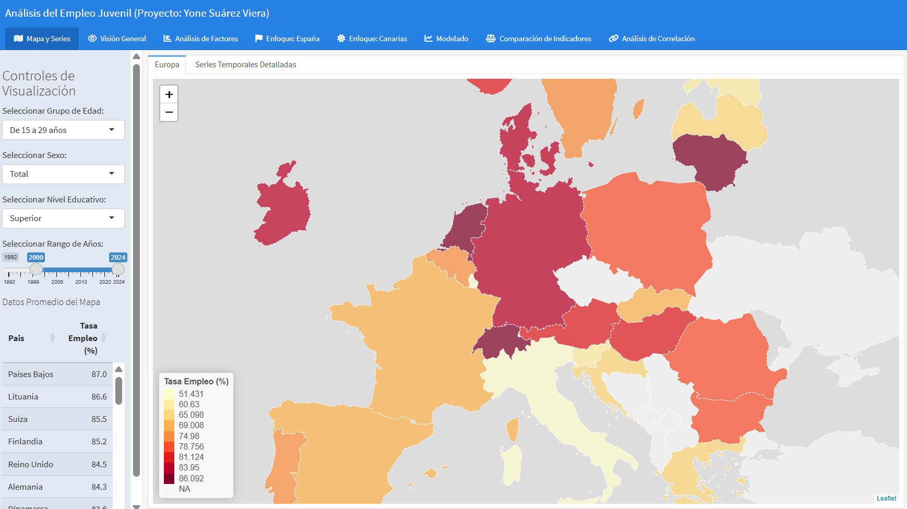
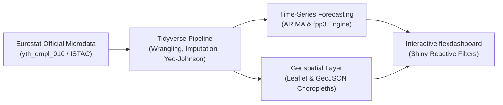

# 📊 European Youth Employment Dynamics & ARIMA Forecasting 🇪🇺

[](https://www.r-project.org/)
[](https://shiny.posit.co/)
[](https://otexts.com/fpp3/)
[](https://ec.europa.eu/eurostat)
[](https://leafletjs.com/)

An econometric and data analytics investigation examining youth employment patterns across European Union member states. The platform combines multivariate statistical modeling, geographic GIS clustering, and **ARIMA time-series forecasting** to analyze employability gaps across education levels, gender, and age cohorts.



---

## 📌 Research Questions & Key Insights

1. **Educational Attainment Impact:** Quantifying employability differences across ISCED levels (Low, Medium, Tertiary).
2. **Gender Disparities:** Identifying persistent employment rate divergence across southern vs. nordic European economies.
3. **Macroeconomic Forecasting:** Training seasonal and non-seasonal **ARIMA models** to project 5-year employment trajectory estimates under structural shifts.

---

## ⚡ Platform Architecture & Features



- **Interactive Dashboard:** Reactive analytics portal built with `flexdashboard` and `Shiny`.
- **Dynamic Cartography:** Interactive European choropleth maps rendered via `leaflet` and customized GeoJSON boundaries.
- **Statistical Rigor:** Parametric and non-parametric data transformations (e.g. Yeo-Johnson), correlation diagnostics, and time-series residual decomposition.
- **Interactive Visuals:** High-density time-series plots powered by `plotly` and `highcharter`.

---

## 🛠️ Tech Stack & Packages

- **Language:** R (v4.0+)
- **Data Manipulation:** `tidyverse` (`dplyr`, `tidyr`, `ggplot2`, `readr`)
- **Dashboard & Reactivity:** `shiny`, `flexdashboard`, `DT`
- **Time-Series & Econometrics:** `fpp3`, `forecast`, `tsibble`
- **Geographic Visualization:** `leaflet`, `geojsonio`
- **Data Ingestion:** `pxR` (PC-Axis format support)

---

## 📂 Repository Structure

```
youth-employment-analysis-europe/
├── Dashboard.Rmd                                # Full interactive Shiny & flexdashboard application
├── Eurostat.Rmd                                 # Exploratory Data Analysis & statistical diagnostics
├── ModeloMemoriaProyectoPersonalAEDV.Rmd        # Comprehensive technical & econometric methodology report
├── utilidades.R                                 # Statistical transform functions (Yeo-Johnson, visual helpers)
├── yth_empl_010.csv                             # Eurostat baseline dataset
├── mapa_paises.geojson                          # European geospatial boundaries
├── dashboard_preview.png                        # Application visual snapshot
├── .gitignore
└── README.md
```

---

## 🚀 Execution & Setup

### Prerequisites
Install [R](https://cloud.r-project.org/) and [RStudio](https://posit.co/download/rstudio-desktop/).

### Installation
```bash
# Clone the repository
git clone https://github.com/yonillo/youth-employment-analysis-europe.git
cd youth-employment-analysis-europe
```

Inside R or RStudio:
```r
# Install required dependencies
install.packages(c(
  "tidyverse", "flexdashboard", "shiny", "plotly", 
  "leaflet", "fpp3", "pxR", "highcharter", "DT"
))

# Launch interactive dashboard
rmarkdown::run("Dashboard.Rmd")
```

---

## 👨‍💻 Author

**Yone Suárez Viera**  
Data Science & Engineering Student @ ULPGC | Gran Canaria 🏝️  
- **LinkedIn:** [yone-suarez](https://linkedin.com/in/yone-suarez)
- **Portfolio:** [yonesuarez.es](https://yonesuarez.es)
